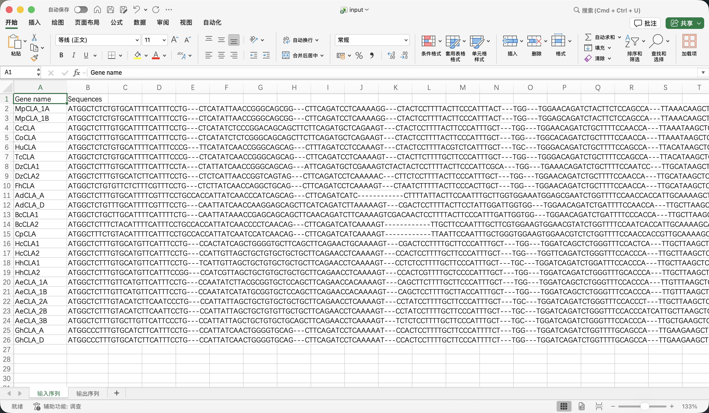
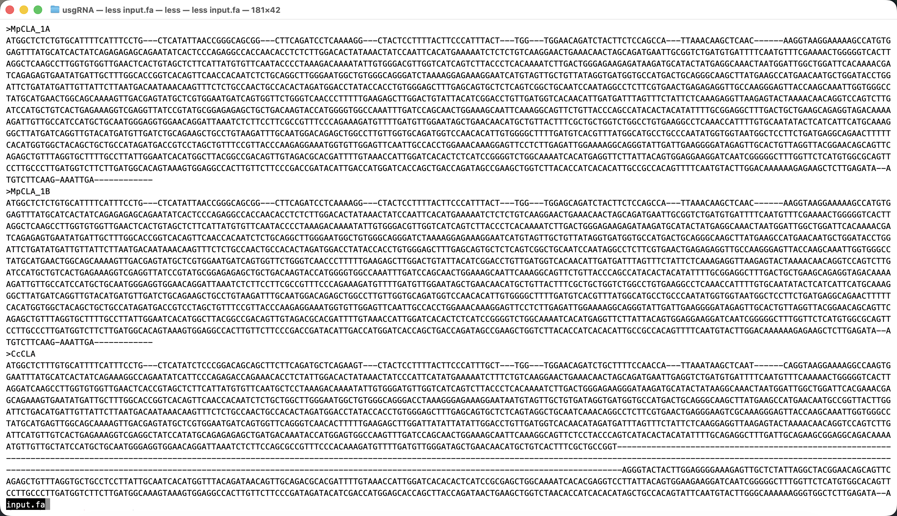
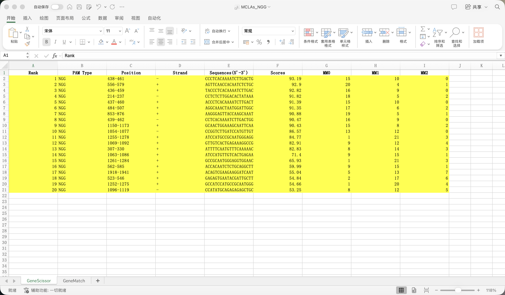
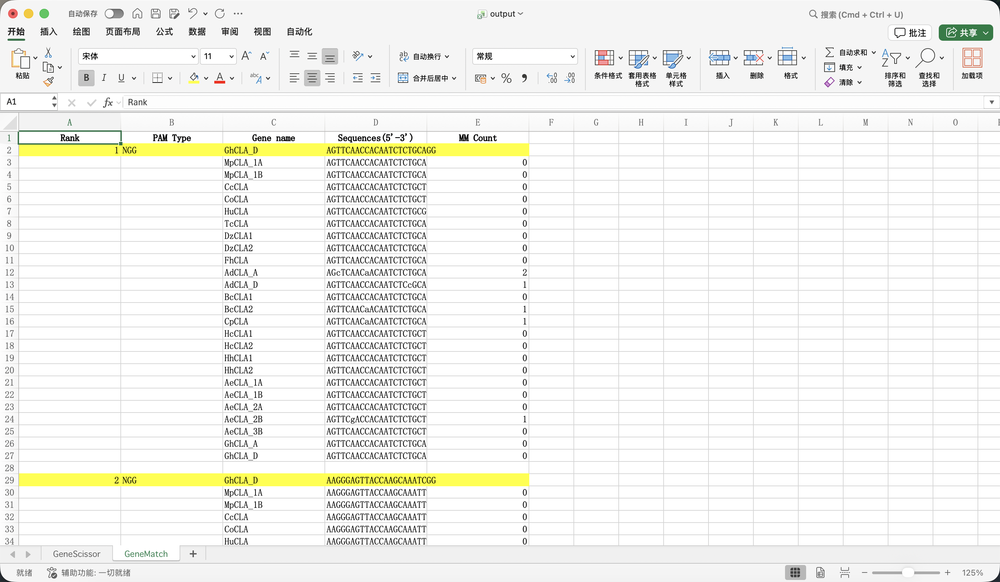

# Gene Sequence Analysis Tool usgRNA-Finder (Universal sgRNA Finder)

This is a Python script for analyzing gene sequences, which can identify specific sequence patterns and generate analysis reports. usgRNA-Finder is a sequence-conservation screening tool that identifies candidate universal sgRNAs (usgRNAs) by scanning input homologous sequences for conserved target sites with no more than two mismatches under specified PAM constraints. The algorithm operates on a pre-aligned sequence set and, under stringent PAM constraints, screens all 23-bp sliding windows and retains the sgRNAs whose corresponding target sites have two or fewer mismatches relative to each input spacer sequence as candidate usgRNAs.

To rank candidate usgRNAs for downstream experimental validation, usgRNA-Finder employs the Cutting Frequency Determination (CFD) score as a mismatch penalty factor to account for the severity of sequence variations. For each input sequence, a specific weight is assigned based on the mismatch type, position, and count according to CFD. The final Score for each usgRNA is calculated as the percentage average of these sequence-specific weights across all input sequences. Importantly, while CFD weights are applied here to penalize mismatches for ranking purposes, the resulting Score does not constitute a validated prediction of sgRNA editing activity across plant species. 

## Requirements

- Python 3.8 or higher
- Required Python packages:
  - pandas
  - openpyxl
  - biopython

## Installation Steps

### Windows

1. Install Python
   - Visit [Python official website](https://www.python.org/downloads/)
   - Download the latest Python installer
   - Run the installer, make sure to check "Add Python to PATH" option
   - Complete the installation

2. Install dependencies
   ```bash
   pip install pandas openpyxl biopython
   ```

### Linux (Ubuntu/Debian)

1. Install Python
   ```bash
   sudo apt update
   sudo apt install python3 python3-pip
   ```

2. Install dependencies
   ```bash
   pip3 install pandas openpyxl biopython
   ```

### macOS

1. Install Python
   - Using Homebrew:
     ```bash
     brew install python
     ```
   - Or download installer from [Python official website](https://www.python.org/downloads/)

2. Install dependencies
   ```bash
   pip3 install pandas openpyxl biopython
   ```

## Usage

1. Prepare input file
   - Create an Excel file named `input.xlsx` or prepare a standard fasta file 
   - The file should contain two columns: gene name and gene sequence
   - First row should be headers, data starts from second row

2. Run the script
   ```bash
   python sequence_search.py
   ```

3. View results
   - After script execution, an `output.xlsx` file will be generated in the same directory
   - The file contains two worksheets:
     - "Gene Scissors": Shows found sequence patterns and their scores
     - "Gene Matches": Shows matching results for each gene

## Notes

- Ensure `input.xlsx` file is in the same directory as the script.
- Input file sequences should use standard DNA base symbols (A, T, C, G), "-" "N" or "ambiguous bases like N, R, Y" can be used to represent missing and unknown bases, the program will skip any 23-bp window containing non-canonical nucleotides.
- Output file will overwrite existing files with the same name.
- The `--pam` parameter to specify the sites to query.

## Example

<p align="center"></p>
<p align="center"></p>
<p align="center"></p>
<p align="center"></p>


## Troubleshooting

1. If you encounter "ModuleNotFoundError", ensure all dependencies are properly installed
2. If you encounter file access permission issues, ensure you have sufficient permissions to read/write the files
3. If you encounter encoding issues, ensure the input file uses UTF-8 encoding 

## Other

- The users should notice that the current version cannot automatically determine whether a candidate target spans two exon.
